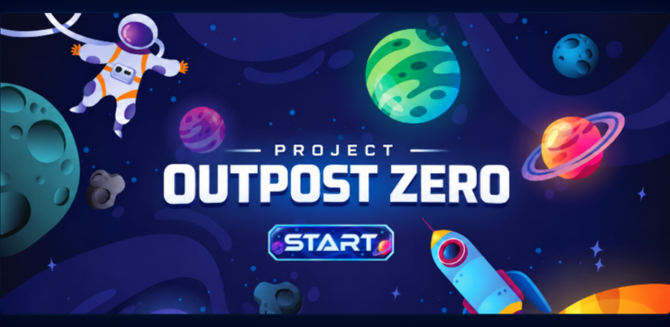
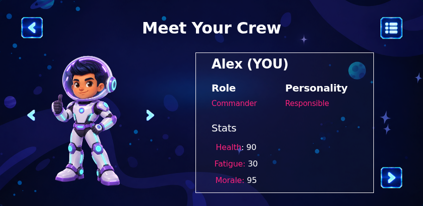
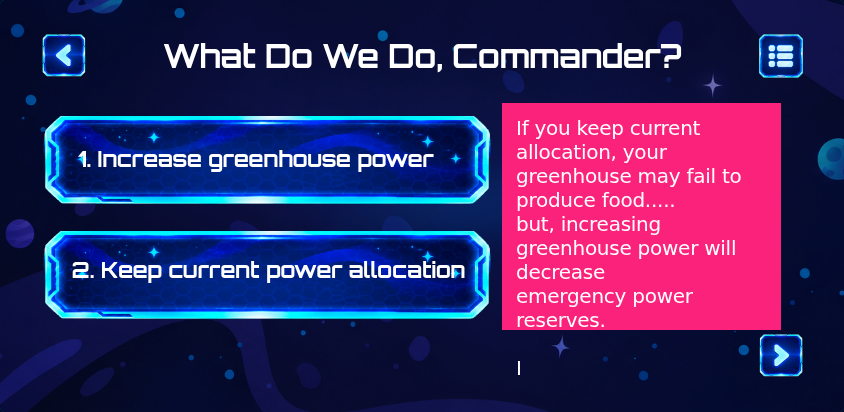
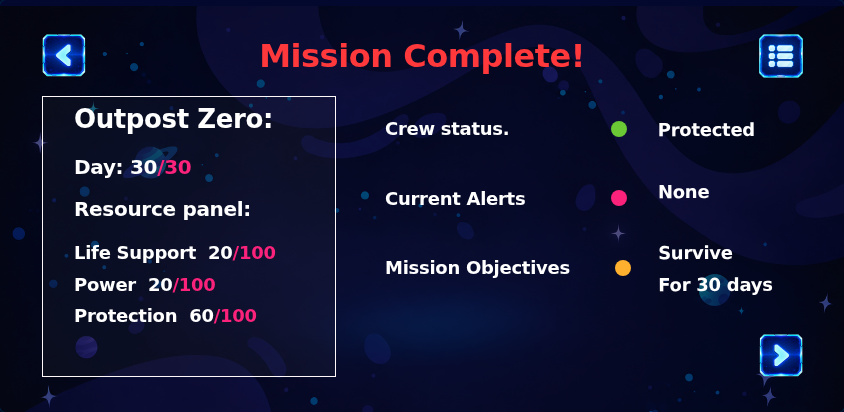

# Project Outpost Zero

An interactive lunar mission experience created for the NASA Space Apps Challenge by Team Ultron.

> [!NOTE]
> **Project description:** Add the final project description here.

## Screenshots

| Mission start | Meet the crew |
| --- | --- |
|  |  |

| Mission decision | Mission debrief |
| --- | --- |
|  |  |

## Features

- 101 screens recreated from the complete Figma design
- Full mission flow from launch preparation through the final debrief
- Four branching commander decisions with different crew and mission outcomes
- Crew profiles, mission dashboards, NASA educational content, and resource trade-offs
- Consistent back, menu, and next controls across the experience
- Mission archive for jumping to any chapter or screen
- Smooth transitions and background image preloading
- Responsive scaling that preserves the original `844 × 412` composition
- Keyboard navigation and reduced-motion support

## Tech Stack

- React 19
- TypeScript 5.7
- Vite 8
- Tailwind CSS 4
- pnpm 10

## Local Setup

### Prerequisites

- [Node.js](https://nodejs.org/) 22
- [pnpm](https://pnpm.io/) 10.34.3 or newer
- Git

The exact versions used by the project are recorded in `.mise.toml`. If you use [mise](https://mise.jdx.dev/), run:

```bash
mise install
```

Otherwise, install or activate pnpm with Corepack:

```bash
corepack enable
corepack prepare pnpm@10.34.3 --activate
```

### Install and Run

```bash
git clone https://github.com/AaronTide/OutpostZero_By_TeamUltron.git
cd OutpostZero_By_TeamUltron
pnpm install
pnpm dev
```

Open [http://localhost:8443](http://localhost:8443) in your browser.

No environment variables or external API keys are required.

If port `8443` is already in use, choose another one:

```bash
PORT=5173 pnpm dev
```

Then open [http://localhost:5173](http://localhost:5173).

## Production Build

Create an optimized production build:

```bash
pnpm build
```

Preview the production build locally:

```bash
pnpm preview
```

The generated static site is written to `dist/`.

## Controls

### On-screen Controls

- **Back button:** return to the previous screen
- **Next button:** continue the mission
- **Menu button:** open the mission menu and screen archive
- **Choice panels:** select a mission decision
- **Crew arrows:** move between crew profiles

### Keyboard Controls

| Key | Action |
| --- | --- |
| <kbd>→</kbd> | Continue to the next screen |
| <kbd>←</kbd> | Return to the previous screen |
| <kbd>Esc</kbd> | Open or close the mission menu |

## Mission Chapters

1. Briefing & Crew
2. Launch & Landing Site
3. Supplies & Shielding
4. Lift-Off & Outpost Setup
5. Day 8: Greenhouse Alert
6. Day 19: Crew Health Alert
7. Gateway & Solar Storm
8. Mission Debrief

## Project Structure

```text
.
├── public/
│   ├── assets/             # Figma artwork, characters, controls, and mission imagery
│   └── fonts/              # Local font files when available
├── src/
│   ├── App.tsx             # Mission flow, branching, navigation, and menu
│   ├── framesData.tsx      # All screen components and frame metadata
│   ├── index.css           # Global styles, fonts, transitions, and interaction states
│   └── main.tsx            # React entry point
├── docs/screenshots/       # README screenshots
├── package.json
└── vite.config.ts
```

## Available Scripts

| Command | Purpose |
| --- | --- |
| `pnpm dev` | Run the Vite development server |
| `pnpm build` | Create a production build |
| `pnpm preview` | Preview the production build |
| `pnpm format` | Format the project with oxfmt |

## Design Source

The interface was designed in Figma and implemented as a React application while preserving the original screen composition, mission flow, typography, artwork, and branching decisions.

## Team

Built by **Team Ultron**.
